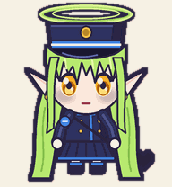
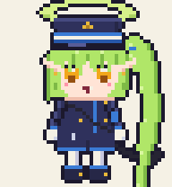
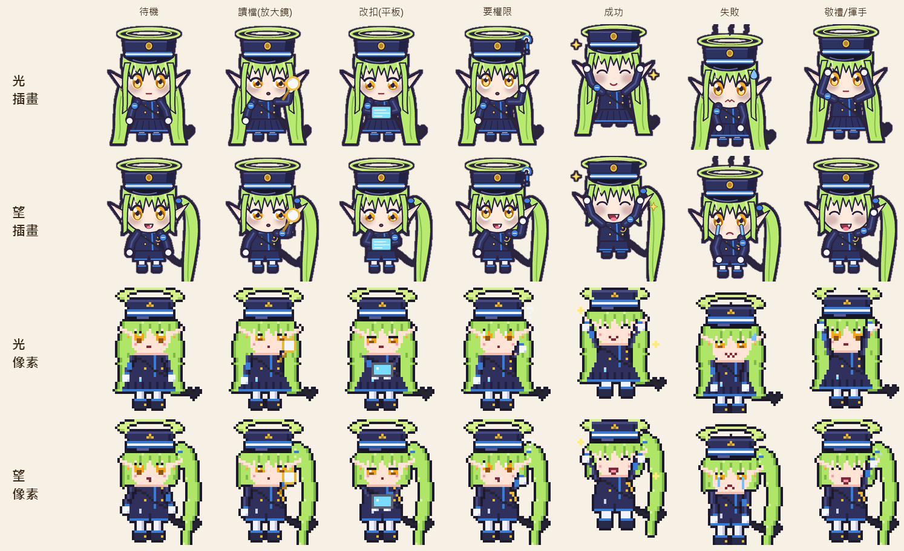
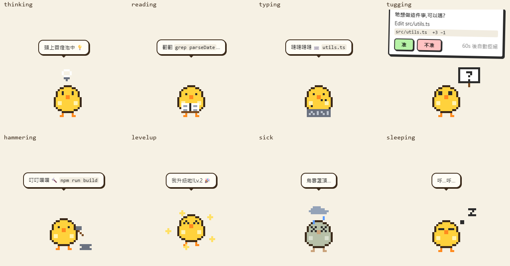
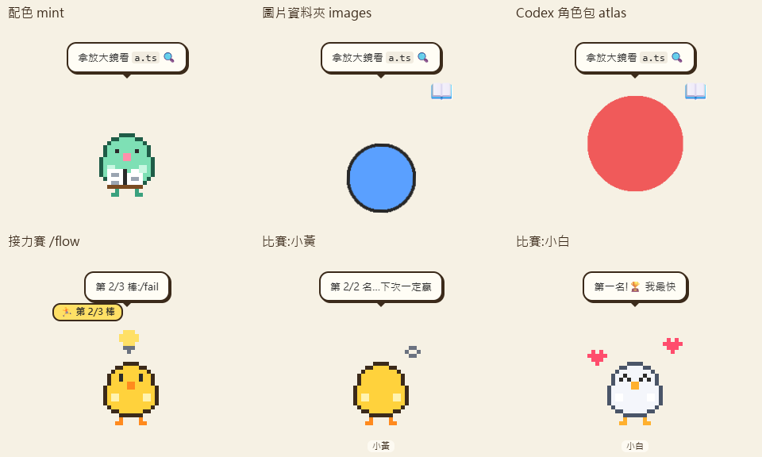

# acp-pet: a desktop pet that acts out what your coding agent is doing

**English** | [繁體中文](README.zh-TW.md)

acp-pet is a small pet that lives on your desktop and shows what a coding agent is doing right now. When the agent reads a file, the pet reads a book. When it edits code, the pet types. When it needs your approval for something risky, the pet holds up a sign with Allow and Deny buttons.

It works with agents that speak [ACP](https://agentclientprotocol.com) (the Agent Client Protocol, a standard way for programs to talk to coding agents), such as Codex or Gemini CLI. The pet doesn't chat and doesn't guess from logs. It reads the agent's real `session/update` events and acts each one out as it arrives.

<p align="center">
  
  
</p>
<p align="center"></p>

The default pets are Hikari and Nozomi from the game Blue Archive ([more below](#hikari-and-nozomi)). There is also a chick drawn in code, and you can use your own images or Codex pet packs.

## What the pet does

Here is how the built-in chick reacts:



| What the agent is doing | What the chick does |
|---|---|
| Thinking or writing a plan | a light bulb above its head, pacing |
| `tool_call` read or search | reads a book |
| `tool_call` edit, delete or move | types fast |
| `tool_call` execute | hammers on an anvil |
| `tool_call` fetch | looks through a telescope |
| `request_permission` | runs over holding a sign with Allow and Deny. Auto-denied after 60 seconds |
| Turn succeeded | jumps with hearts, and levels up when it has enough XP |
| Turn failed | turns grey under a rain cloud |
| Permission denied or task cancelled | turns its back on you |
| Idle for a long time | gets bored, then falls asleep |

On top of that there is a small virtual-pet game. Energy drains with every tool call and refills while the pet sleeps. Boredom rises while it is idle, and when it is high enough the pet comes over to ask for a task. Every finished task gives XP, and a streak of successes gives a bonus. The chick grows a comb at level 3 and a crown at level 5. Everything is saved in `~/.acp-pet/`.



## Install and run

You need Node.js and npm, plus a coding agent that is already installed and logged in. The pet starts agents through [acpx](https://github.com/openclaw/acpx), a tool that runs ACP agents. acpx is installed by `npm install`.

```bash
npm install
npm run demo      # a scripted demo turn, no agent needed
npm start         # the real thing
```

Both commands build the app first, then open it with Electron.

Controls:

- Click the pet to pet it. Double-click to open the task box. Drag to move it.
- Right-click the pet, or click the tray icon, for the menu.

What you can type in the task box:

| Input | What happens |
|---|---|
| `fix the failing test` | sent to the real agent |
| `/demo`, `/fail` | scripted turns, one success and one failure |
| `/flow step one >> step two >> step three` | a relay: the steps run one after another in the same session, with a "2/3" badge. It stops at the first step that fails |

The menu text is in Chinese. The main items are: 餵任務 (give a task), 示範表演 (demo), 外表 (looks), 寵物日記 (diary), 睡覺 (sleep), 比賽 (race), 新增一隻寵物 (add a pet), 大小 (size), 永遠在最上層 (always on top), 唸出台詞 (read aloud), 自由走動・互動 (wander), 離開 (quit).

## Hikari and Nozomi

The two default pets are the Tachibana twins from Blue Archive: Hikari (calm, deadpan, salutes at the cap) and Nozomi (side ponytail, fang grin). Scripts in `scripts/pets/` draw every frame, and each pet has two looks that you switch under the 外表 menu:

- Illustrated (`hikari`, `nozomi`, the default): a smooth chibi drawing. `draw_twins_hd.py` paints each frame at 4x size, shrinks it to smooth the edges, and adds a sticker outline.
- Pixel (`hikari-pixel`, `nozomi-pixel`): 48x52 pixel art, scaled 4x by `draw_twins.py` with sharp edges. Previews are in `docs/pets/*-pixel.gif`.

Both are Codex pet packs in the v2 format: `pets/<id>/pet.json` plus an 8x11 `spritesheet.webp`. The same format is used by [awesome-codex-pet](https://github.com/legeling/awesome-codex-pet). v2 packs include 16 look directions, so an idle pet turns to follow your mouse.

- To use them in Codex too, run `npm run pets:install-codex`. It copies them to `~/.codex/pets/`. Then pick one in Codex settings.
- To redraw them after editing the scripts, run `npm run pets:draw`. This needs Python with Pillow.
- They are fan art. See [ASSETS-LICENSE.md](ASSETS-LICENSE.md). The characters belong to NEXON Games and Yostar, and the sprites are for non-commercial use.

## Several pets and racing

The 新增一隻寵物 menu item adds another pet to the desktop. Each pet has its own agent, workspace, look and save file. The 比賽 item sends the same task to every idle pet at once. The first to finish gets a trophy and 15 bonus XP, and the others sulk. To race different agents against each other, give each pet a different `agent` in the config.

## Life on the desktop

Like the classic [Shimeji](https://kilkakon.com/shimeji/), the pets move around while you work on something else:

- They stroll back and forth along the bottom of the screen, at the height where you left them.
- Two idle pets walk to each other and chat. Hikari and Nozomi have their own twin banter.
- When your mouse comes close, they sometimes turn and say hi.
- Now and then they mumble to themselves.

They stay put while working, while holding a permission sign, while being dragged, and for a minute after you drop them. A mouse resting on a pet also keeps it from walking off. The 自由走動・互動 menu item turns all of this off. You can also set `"wander": false` in the config.

## Looks (skins)

The 外表 menu switches a pet's appearance. There are three kinds:

1. Built-in looks: Hikari and Nozomi, plus the code-drawn chick in five colors (chick, snow, mint, sakura, night). The chicks come with hand-drawn props such as a book, keyboard and hammer.
2. Your own pictures. Make a folder in `~/.acp-pet/skins/` with one image per pose. PNG, GIF (animated is fine), WebP and JPG all work. Only `idle` is required. Missing poses fall back to another pose:

   ```
   ~/.acp-pet/skins/my-cat/
   ├── idle.gif        required
   ├── working.gif     used for thinking, reading, typing, hammering and peeking
   ├── happy.png       also used for levelup
   ├── sick.png        also used for sulking
   ├── reading.png     any pose name overrides the fallback (see the table above)
   └── skin.json       optional: { "name": "My cat", "pixelated": true }
   ```

   Picture skins have no hand-drawn props. The pet shows a badge and moves (hops, shakes, sways) to say what it is doing.
3. Codex pet packs. Put a pet pack folder (`pet.json` plus a spritesheet with 192x208 cells; v1 is 8x9, v2 is 8x11) into `~/.acp-pet/skins/`. It works as it is, so you can reuse the pets on [awesome-codex-pet](https://github.com/legeling/awesome-codex-pet) or [OpenPet](https://github.com/dengyie/OpenPet).

The menu re-reads the folder each time it opens, so new skins show up without a restart. Images over 8 MB, and paths that point outside the skin folder, are refused.

## Configuration

On first launch the app writes `~/.acp-pet/config.json`:

```json
{
  "pets": [
    { "id": "pet1", "name": "ヒカリ", "agent": "claude", "workspace": "C:\\Users\\you\\acp-pet-workspace", "skin": "hikari" }
  ],
  "permissionTimeoutSec": 60,
  "scale": 1,
  "alwaysOnTop": true,
  "tts": false,
  "wander": true
}
```

- `agent` is any [acpx agent name](https://github.com/openclaw/acpx), such as `codex` or `gemini`. The agent must already be installed and logged in.
- `workspace` is the folder the agent works in. Use a separate practice folder for each pet.
- `scale` (0.75, 1, 1.25, 1.5 or 2), `alwaysOnTop`, `tts` (read the speech bubbles aloud) and `wander` can also be changed from the menu.
- An old v0.1 config (`{ "agent", "workspace" }`) is converted automatically.

## Safety

acpx is not a sandbox, so the pet adds its own guard rails:

- Permissions fail closed. Read, search and think are allowed automatically. Anything else (edit, execute, fetch and so on) needs you to click Allow. If you don't answer before the timeout, it is denied.
- acpx's client-side file and terminal callbacks are turned off, so `request_permission`, and with it the pet's sign, is the only gate.
- Each pet's `workspace` must be a dedicated folder. The app refuses your home directory, a drive root, `~/.ssh`, `~/.aws`, `~/.gnupg`, `~/.config` and `~/.acp-pet`.
- `/flow` relays run on the pet's own session and not on acpx's `FlowRunner`, because `FlowRunner` has no permission callback and would skip the sign.
- For real isolation, run the agent as a separate user or in a container.

## How it is built

```
acpx runtime ─ AcpRuntimeEvent ─▶ AcpEventNormalizer ─ PetEvent ─▶ PetBrain ─ PetSnapshot ─▶ renderer (sprite / skin)
      ▲                                                                ▲
      └──── onPermissionRequest ──▶ PermissionGate ──── sign ──────────┘ ◀── Allow / Deny
```

| File | What it does |
|---|---|
| `src/core/acp-source.ts` | The only file that touches acpx. acpx is pre-1.0, so the coupling stays in one place |
| `src/core/brain.ts` | State machine: maps events to poses and tracks the pet's stats. It has no clock of its own, so it is deterministic |
| `src/core/permission.ts` | Permission gate that fails closed, with a timeout |
| `src/core/controller.ts` | Wires one pet together, plus relay runs. No Electron code |
| `src/core/race.ts` | Race referee |
| `src/core/ambient.ts` | Decides who strolls, chats or says hi next |
| `src/core/skins.ts` | Loads skins: recolors, picture folders, Codex pet packs (v1 and v2) |
| `src/core/look.ts` | v2 look-around: mouse angle to one of 16 frames |
| `src/core/fake-source.ts` | Scripted turns for `/demo` and `/fail` |
| `src/main/` | Electron side: one transparent click-through window per pet, tray, menus, settings |
| `src/renderer/` | Pixel sprite drawn in code, skin rendering, speech bubble, permission sign, read-aloud |
| `pets/` | Bundled pet packs (Hikari and Nozomi, illustrated and pixel) |
| `scripts/pets/` | Python scripts that draw the pet sprite sheets |

## Tests

```bash
npm test          # unit and integration tests
npm run smoke     # starts the real Electron app and runs about 30 checks; screenshots go to smoke-out/
ACP_PET_LIVE=1 npx vitest run test/live.test.ts   # drives a real agent in a temp folder: one turn and a two-step relay (uses your agent quota)
```

## Credits

- [acpx](https://github.com/openclaw/acpx): the ACP runtime
- [qq-slime-pet](https://github.com/DTSFO/qq-slime-pet): sprites drawn in code, and the click-through hit-test trick
- [Shimeji](https://kilkakon.com/shimeji/): the idea of desktop pets that wander on their own
- [awesome-codex-pet](https://github.com/legeling/awesome-codex-pet): the Codex pet v2 format
- [OpenPet](https://github.com/dengyie/OpenPet): the Codex pet pack layout
- [codex-has-a-pet-too](https://github.com/ChenxiChu001/codex-has-a-pet-too) and [miku-on-desktop](https://github.com/thunguo/miku-on-desktop): other agent pets that inspired this one

## License

Code: MIT. The Hikari and Nozomi sprites are Blue Archive fan art for non-commercial use. See [ASSETS-LICENSE.md](ASSETS-LICENSE.md).
