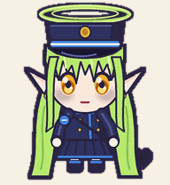
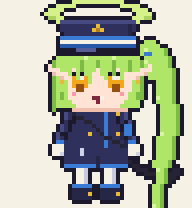
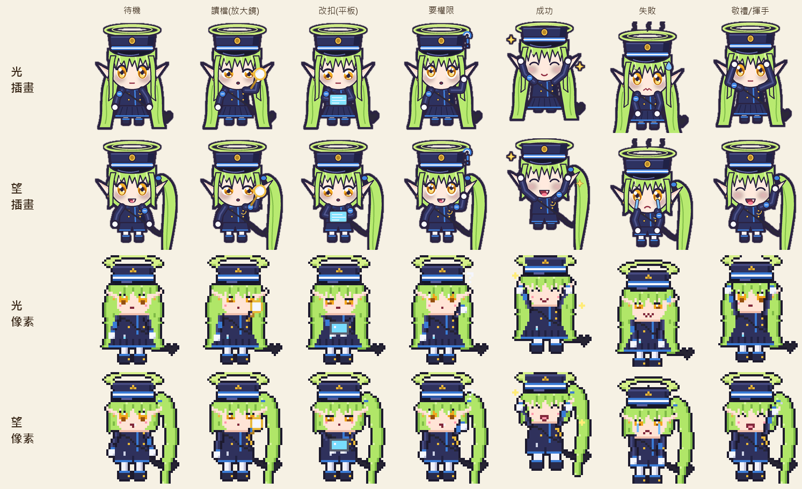
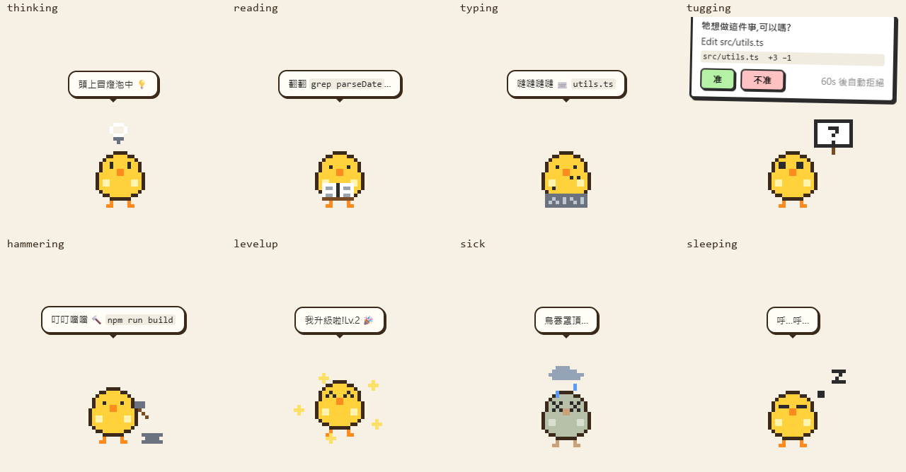
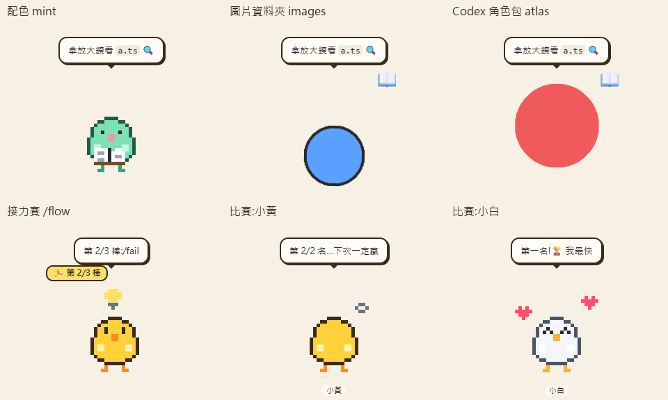

# acp-pet:會演出 coding agent 在做什麼的桌面寵物

[English](README.md) | **繁體中文**

acp-pet 是一隻住在桌面上的小寵物,會即時演出 coding agent 正在做的事。agent 在讀檔案,寵物就翻書;agent 在改程式,寵物就打字;agent 要做有風險的事、需要你同意時,寵物會舉一塊寫著「准」和「不准」的牌子跑過來問你。

它支援講 [ACP](https://agentclientprotocol.com)(Agent Client Protocol,程式與 coding agent 溝通的標準協定)的 agent,例如 Claude Code（預設）、Codex 或 Gemini CLI。寵物不聊天,也不靠讀 log 猜。它直接讀 agent 真實的 `session/update` 事件,事件一來就演出來。

<p align="center">
  
  
</p>
<p align="center"></p>

預設的寵物是遊戲《蔚藍檔案》的ヒカリ和ノゾミ([見下方](#ヒカリ與ノゾミ))。另外還有用程式畫的小雞,也可以用你自己的圖片或 Codex 角色包。

## 寵物會做什麼

內建小雞的反應如下:



| agent 在做什麼 | 小雞在做什麼 |
|---|---|
| 思考或列計畫 | 頭上冒燈泡、踱步 |
| `tool_call` read / search | 翻書 |
| `tool_call` edit / delete / move | 快速打字 |
| `tool_call` execute | 在鐵砧上敲榔頭 |
| `tool_call` fetch | 拿望遠鏡看 |
| `request_permission` | 舉牌跑過來,牌上有「准」和「不准」。60 秒沒回應就自動拒絕 |
| turn 成功 | 開心跳,冒出愛心;經驗值夠就升級 |
| turn 失敗 | 變灰,頭上一朵烏雲下雨 |
| 權限被拒或任務被取消 | 轉過身去生悶氣 |
| 閒置很久 | 變無聊,然後睡著 |

上面還疊了一層簡單的電子雞養成。體力每次 tool call 都會下降,睡覺時恢復。無聊值在閒置時上升,高到一定程度,寵物會跑來向你討任務。每完成一個任務得到經驗值(XP),連續成功有額外加成。小雞 Lv.3 長雞冠,Lv.5 戴皇冠。所有資料存在 `~/.acp-pet/`。



## 安裝與執行

需要 Node.js 和 npm,以及一個已經裝好並登入的 coding agent。寵物透過 [acpx](https://github.com/openclaw/acpx)(執行 ACP agent 的工具)啟動 agent,`npm install` 會一併裝好 acpx。

```bash
npm install
npm run demo      # 腳本示範,不需要 agent
npm start         # 正式使用
```

兩個指令都會先 build,再用 Electron 開啟。

操作方式:

- 單擊寵物摸摸牠,雙擊開啟任務框,拖曳可以移動位置。
- 在寵物上按右鍵,或點托盤圖示,開啟選單。

任務框可以輸入:

| 輸入 | 會發生什麼 |
|---|---|
| `修好那個壞掉的測試` | 送給真的 agent |
| `/demo`、`/fail` | 腳本演出,一次成功、一次失敗 |
| `/flow 第一步 >> 第二步 >> 第三步` | 接力賽:各步驟在同一個 session 裡依序執行,畫面上有「2/3」徽章。哪一步失敗就停 |

選單的主要項目:餵任務、示範表演、外表、寵物日記、睡覺、比賽、新增一隻寵物、大小、永遠在最上層、唸出台詞 (TTS)、自由走動・互動、離開。

## ヒカリ與ノゾミ

預設的兩隻是《蔚藍檔案》的橘家雙胞胎:ヒカリ(Hikari)淡定,會在帽簷敬禮;ノゾミ(Nozomi)綁側馬尾,笑起來露虎牙。`scripts/pets/` 裡的腳本畫出每一格動畫,每隻都有兩種畫風,在選單的「外表」切換:

- 插畫風(`hikari`、`nozomi`,預設):平滑的 Q 版插畫。`draw_twins_hd.py` 先用 4 倍大小畫每一格,再縮小讓邊緣平滑,最後加上貼紙描邊。
- 像素風(`hikari-pixel`、`nozomi-pixel`):`draw_twins.py` 畫出 48×52 的像素圖並放大 4 倍,邊緣保持銳利。預覽動畫在 `docs/pets/*-pixel.gif`。

兩種都是 Codex 角色包 v2 格式:`pets/<id>/pet.json` 加一張 8×11 格的 `spritesheet.webp`。[awesome-codex-pet](https://github.com/legeling/awesome-codex-pet) 用的也是這個格式。v2 角色包有 16 個看的方向,所以閒著的寵物會轉頭跟著你的滑鼠看。

- 想在 Codex 裡也用,執行 `npm run pets:install-codex`,它會複製到 `~/.codex/pets/`,再到 Codex 設定裡選。
- 改了腳本想重畫,執行 `npm run pets:draw`,需要 Python 和 Pillow。
- 這些是同人二創,詳見 [ASSETS-LICENSE.md](ASSETS-LICENSE.md)。角色版權屬於 NEXON Games 和 Yostar,圖片僅限非商業使用。

## 多隻寵物與比賽

選單的「新增一隻寵物」會在桌面多放一隻。每隻都有自己的 agent、workspace、外表和存檔。「比賽」會把同一個任務同時丟給所有閒著的寵物,最先完成的拿到獎盃和 15 點額外 XP,其他的生悶氣。想讓不同的 agent 互相比,就在設定檔裡給每隻寵物填不同的 `agent`。

## 桌面上的生活

像經典的 [Shimeji](https://kilkakon.com/shimeji/) 一樣,你忙別的事時,寵物也會自己動:

- 牠們會沿著螢幕底部來回散步,高度維持在你放下的位置。
- 兩隻閒著的寵物會走到彼此身邊聊天。ヒカリ和ノゾミ有專屬的雙胞胎對話。
- 滑鼠靠近時,牠們有時會轉過來打招呼。
- 偶爾會自言自語。

工作中、舉著權限牌時、被拖曳時,以及被你放下後的一分鐘內,牠們會待在原地。滑鼠停在寵物上也會讓牠不走開。選單的「自由走動・互動」可以把這些全部關掉,也可以在設定檔寫 `"wander": false`。

## 外表(skin)

選單的「外表」可以換寵物的樣子。共有三種:

1. 內建外表:ヒカリ、ノゾミ,以及五種顏色的程式小雞(小黃雞、雪白鴨、薄荷史萊姆、櫻花雞、夜貓)。小雞有手繪的道具,例如書、鍵盤、榔頭。
2. 你自己的圖片。在 `~/.acp-pet/skins/` 建一個資料夾,每個動作放一張圖。支援 PNG、GIF(動畫也可以)、WebP、JPG。只有 `idle` 是必要的,缺少的動作會自動換用別的動作:

   ```
   ~/.acp-pet/skins/my-cat/
   ├── idle.gif        必要
   ├── working.gif     思考、讀檔、打字、敲榔頭、偷看時使用
   ├── happy.png       升級時也用
   ├── sick.png        生悶氣時也用
   ├── reading.png     任何動作名稱都能覆蓋預設(見上面的表)
   └── skin.json       選填:{ "name": "My cat", "pixelated": true }
   ```

   圖片外表沒有手繪道具,寵物會用徽章和動作(跳、抖、搖)表示它在做什麼。
3. Codex 角色包。把角色包資料夾(`pet.json` 加每格 192×208 的 spritesheet;v1 是 8×9,v2 是 8×11)放進 `~/.acp-pet/skins/`,直接就能用,所以 [awesome-codex-pet](https://github.com/legeling/awesome-codex-pet) 或 [OpenPet](https://github.com/dengyie/OpenPet) 上的角色都可以拿來用。

選單每次打開都會重新讀取資料夾,新加的外表不用重開就會出現。超過 8 MB 的圖片,以及指到外表資料夾之外的路徑,都會被拒絕。

## 設定

第一次啟動時,程式會寫出 `~/.acp-pet/config.json`:

```json
{
  "pets": [
    { "id": "pet1", "name": "ヒカリ", "agent": "claude", "workspace": "C:\\Users\\you\\acp-pet-workspace", "skin": "hikari" }
  ],
  "permissionTimeoutSec": 60,
  "scale": 1,
  "alwaysOnTop": true,
  "tts": false,
  "wander": true
}
```

- `agent` 可以是任何 [acpx 的 agent 名稱](https://github.com/openclaw/acpx),例如 `codex` 或 `gemini`。該 agent 必須已經安裝並登入。
- `workspace` 是 agent 工作的資料夾。每隻寵物請各用一個獨立的練習用資料夾。
- `scale`(0.75、1、1.25、1.5 或 2)、`alwaysOnTop`、`tts`(把對話框的台詞唸出來)和 `wander` 也可以從選單改。
- 舊的 v0.1 設定檔(`{ "agent", "workspace" }`)會自動轉換。

## 安全

acpx 不是沙箱,所以寵物自己加了幾道防護:

- 權限預設拒絕。讀取、搜尋、思考會自動放行。其他動作(編輯、執行、fetch 等)都要你按「准」。逾時沒回應就視為拒絕。
- acpx 的 client 端檔案與終端機 callback 都關掉了,所以 `request_permission`,也就是寵物舉的牌子,是唯一的關卡。
- 每隻寵物的 `workspace` 必須是專用資料夾。程式會拒絕你的家目錄、磁碟根目錄、`~/.ssh`、`~/.aws`、`~/.gnupg`、`~/.config` 和 `~/.acp-pet`。
- `/flow` 接力賽是跑在寵物自己的 session 上,而不是 acpx 的 `FlowRunner`,因為 `FlowRunner` 沒有權限 callback,會繞過牌子。
- 想要真正的隔離,請用另一個使用者帳號或容器來執行 agent。

## 程式架構

```
acpx runtime ─ AcpRuntimeEvent ─▶ AcpEventNormalizer ─ PetEvent ─▶ PetBrain ─ PetSnapshot ─▶ renderer (sprite / skin)
      ▲                                                                ▲
      └──── onPermissionRequest ──▶ PermissionGate ──── sign ──────────┘ ◀── 准 / 不准
```

| 檔案 | 用途 |
|---|---|
| `src/core/acp-source.ts` | 唯一接觸 acpx 的檔案。acpx 還沒到 1.0,所以把耦合集中在一處 |
| `src/core/brain.ts` | 狀態機:把事件對應成動作,並記錄寵物的數值。它自己沒有時鐘,所以行為是確定的 |
| `src/core/permission.ts` | 預設拒絕的權限閘門,有逾時 |
| `src/core/controller.ts` | 把一隻寵物接起來,也負責接力賽。不含 Electron 程式碼 |
| `src/core/race.ts` | 比賽裁判 |
| `src/core/ambient.ts` | 決定下一個要散步、聊天還是打招呼的是誰 |
| `src/core/skins.ts` | 載入外表:換色、圖片資料夾、Codex 角色包(v1 與 v2) |
| `src/core/look.ts` | v2 的轉頭看:滑鼠角度對應到 16 格其中之一 |
| `src/core/fake-source.ts` | `/demo` 和 `/fail` 用的腳本演出 |
| `src/main/` | Electron 端:每隻寵物一個透明、可穿透點擊的視窗,還有托盤、選單、設定 |
| `src/renderer/` | 用程式畫的像素 sprite、外表顯示、對話框、權限牌、唸台詞 |
| `pets/` | 內附的角色包(ヒカリ和ノゾミ,插畫版與像素版) |
| `scripts/pets/` | 畫寵物 sprite sheet 的 Python 腳本 |

## 測試

```bash
npm test          # 單元與整合測試
npm run smoke     # 啟動真正的 Electron 程式並跑約 30 項檢查,截圖放在 smoke-out/
ACP_PET_LIVE=1 npx vitest run test/live.test.ts   # 在暫存資料夾驅動真的 agent:一個 turn 加一次兩步的接力(會用掉 agent 額度)
```

## 致謝

- [acpx](https://github.com/openclaw/acpx):ACP runtime
- [qq-slime-pet](https://github.com/DTSFO/qq-slime-pet):用程式畫 sprite,以及點擊穿透的判斷技巧
- [Shimeji](https://kilkakon.com/shimeji/):桌寵自己走動的點子
- [awesome-codex-pet](https://github.com/legeling/awesome-codex-pet):Codex pet v2 格式
- [OpenPet](https://github.com/dengyie/OpenPet):Codex 角色包的資料夾結構
- [codex-has-a-pet-too](https://github.com/ChenxiChu001/codex-has-a-pet-too) 和 [miku-on-desktop](https://github.com/thunguo/miku-on-desktop):啟發這個專案的其他 agent 寵物

## 授權

程式碼:MIT。ヒカリ和ノゾミ的圖片是《蔚藍檔案》同人二創,僅限非商業使用,詳見 [ASSETS-LICENSE.md](ASSETS-LICENSE.md)。
